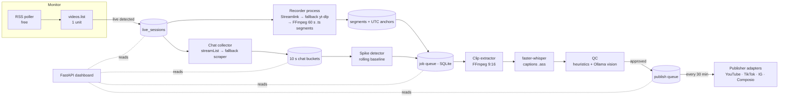

# Phase 1 — Research, Validation & Proposed Architecture

Status: **historical**. This is the research done before building (2026-11-23). It was approved and then
implemented; where reality differed (e.g. quota costs, chat coverage, the private-upload lock), the current
behaviour is in [architecture.md](architecture.md) and the notes in [../CLAUDE.md](../CLAUDE.md).

---

## 0. TL;DR

| Area | Verdict |
|---|---|
| Recording (Streamlink) | Viable. Streamlink 8.6.2 (2026-10-07) has a working YouTube live plugin (live fix landed in 8.1.2). Known open issue: bot-check / `LOGIN_REQUIRED` (#6940). **yt-dlp is the fallback**, already installed. Local verification: see §2.1. |
| Live detection | Free and nearly quota-free: channel RSS feed + `videos.list` (1 unit / 50 videos). **Avoid `search.list`.** |
| Live chat | `liveChatMessages.streamList` (server push, 5 units per *connection*) is the only quota-sane official option. Polling `list` every 10 s would cost ~7,200 units for one 4-hour stream. |
| Timestamp sync | Use HLS `EXT-X-PROGRAM-DATE-TIME` (absolute UTC per segment) if present; fall back to local NTP-synced wall clock. Chat is *behind* video by viewer latency + reaction time — must be compensated. |
| Transcription | faster-whisper (MIT), CPU int8. No GPU on this laptop — fine for 30–45 s clips. |
| AI QC | Ollama + `gemma4:e2b` (already installed, accepts images). CPU-only → minutes per clip, which still fits a 30-min publish cadence. |
| Publishing | **YouTube Shorts: free & direct** (videos now public by default from unverified projects since 2026-11-02). **TikTok: private-only until audit.** **Instagram: needs Business account + Meta app + public video URL.** Composio free tier (10k calls/mo) works but adds no capability we can't get directly. |
| **Biggest risk** | **Not technical — rights.** Re-uploading other streamers' footage without permission is copyright infringement and violates YouTube's reused-content policy. See §8. |

---

## 1. This laptop (measured)

| Item | Value | Implication |
|---|---|---|
| CPU | Intel i5-1245U (10 cores / 12 threads, 15 W U-series) | Good for bursts, thermally throttles under sustained load → run heavy jobs **one at a time** in a queue. |
| GPU | Intel Iris Xe (no NVIDIA / CUDA) | Whisper and Ollama run on CPU. FFmpeg can use **Intel Quick Sync** (`h264_qsv`, `hevc_qsv`) — verified present in local FFmpeg 8.1.2. |
| RAM | 32 GB | Comfortable: Whisper small (~1.5 GB) + gemma4:e2b (~5 GB) + recorders. |
| Disk | C: 21 GB free · **P: 78 GB free** | All recordings/clips go on P:. Retention policy is mandatory (see §4). |
| Python | 3.12.13 available via `py -V:Astral/CPython3.12.13` (bare `python` is the MS Store stub) | Project will use a venv pinned to 3.12. |
| FFmpeg | 8.1.2 full build (gyan.dev) — includes libass (subtitle burn-in), libx264, QSV | No install needed. |
| yt-dlp | 2026.07.04 — **>90 days old, must update** (`yt-dlp -U` or `winget upgrade yt-dlp`) | YouTube breaks old versions frequently. |
| Ollama | 0.40.16 with `gemma4:e2b` (4.6 GB) | Ready for Phase 8. |
| Git | 2.50.1 | Project dir is not yet a git repo. |
| Streamlink | Not installed | Install into project venv (pip). |

---

## 2. Tool-by-tool findings

### 2.1 Streamlink (recording) — BSD-2-Clause, free
- Current release **8.6.2 (2026-10-07)**. YouTube live support was broken in early 2026 and fixed in 8.1.2 (2026-01-18, PR #6777). An InnerTube 400 error (#6852/#6855) appeared in March.
- Open issue **#6940**: YouTube returning "Sign in to confirm you're not a bot" even with cookies. This is the main operational risk; it hits yt-dlp-style tools as well.
- Streamlink's YouTube plugin handles **live only** (no VODs, no protected/members content).
- **Local test result:** not yet verified on this laptop (install stalled, see §9). This is the first task of Phase 3.
- **Decision:** Streamlink as the primary recorder, **yt-dlp as an automatic fallback**, both behind one `Recorder` interface. Keep both updated; YouTube breakage is a "when", not an "if".

### 2.2 FFmpeg — LGPL/GPL, free
Handles stream remux to segments, clip cut, 9:16 reframing, subtitle burn-in (libass), loudness normalisation, encode (QSV hardware or libx264 fallback).

### 2.3 YouTube Data API v3 — free, quota-limited
Default project quota is **10,000 units/day**. Since **2026-06-01**, `videos.insert` and `search.list` each draw from **their own separate buckets** (limits visible in Google Cloud Console; request more through the Quota Extension Form).

| Operation | Cost | Our usage |
|---|---|---|
| `channels.list` (resolve `@handle` → channel ID) | 1 | Once per channel added |
| `search.list` (eventType=live) | 100 | **Do not use** for monitoring |
| `videos.list` (live status, up to 50 IDs per call) | 1 | Poll every 1–2 min → ≤1,440/day |
| `liveChatMessages.list` (polling) | 5 per call | Every 10 s × 4 h = **7,200 units/stream**. Too expensive. |
| `liveChatMessages.streamList` (server push) | 5 per connection | ~1 reconnect/10 min × 4 h ≈ **120 units/stream** |
| `videos.insert` (upload) | ~100 (since 2025-12-04, was ~1,600) | Own bucket |

**Live detection without quota:** each channel has a free RSS feed (`https://www.youtube.com/feeds/videos.xml?channel_id=UC…`) listing recent videos, including live and upcoming broadcasts. New IDs from RSS go to `videos.list`, which returns `liveStreamingDetails.actualStartTime/actualEndTime` and `activeLiveChatId`. A zero-quota fallback is to resolve `youtube.com/channel/<id>/live` with Streamlink or yt-dlp.

**Auth:** an **API key** covers public reads (channels, videos, and probably public chat). **OAuth 2.0** (Google Cloud "Desktop app" client, free) is required for uploads. The docs do not say whether `streamList` accepts an API key for *other people's* public streams. **This gets verified on day one of Phase 4.**

**Unofficial chat fallback (zero quota):** `chat-downloader` (MIT) or `pytchat` read chat through YouTube's internal web endpoints. They are free and fast but break when YouTube changes, and they sit in a ToS grey area. Offered as a switchable fallback, not the default.

### 2.4 faster-whisper — MIT, free, local
- Reference: `small` model, int8, 8 threads on an i7-12700K ≈ **7.6× real-time** using ~1.5 GB RAM. Expect roughly 3–5× on this U-series CPU, so **~10–15 s per 45 s clip**.
- Some target streamers speak **Hindi/Hinglish** (seen in today's live list), so use the **multilingual `small`** model, not `*.en`. Language is auto-detected per clip and can be overridden per channel.
- `word_timestamps=True` gives word-level timing for karaoke-style captions written as `.ass` subtitles and burned in with libass.

### 2.5 Ollama + vision model — MIT (Ollama), Gemma licence (model), free, local
- `gemma4:e2b` (already installed) accepts **text + image** input in Ollama. Use the standard tag; `-mlx` tags are text-only.
- QC input: ~6 sampled frames (FFmpeg scene-change or uniform sampling), the transcript, and chat-spike statistics. Output: strict JSON (`score`, sub-scores, `reason`, `reject`).
- On CPU, expect **~1–3 min per clip**. With one publish every 30 min (48/day max), that is acceptable.
- A 2B-class model scores noisily. The final score blends **objective signals** (chat spike strength, audio loudness/peaks, speech density, black/frozen frame detection) with the LLM judgement. The LLM can veto but cannot be the only gate.

### 2.6 Composio — free tier with limits (cloud service)
Live pricing page (checked today):
- **Free:** $0, no card, **10,000 tool calls/month**, up to 3 members, 10 linked accounts per app, $2 one-time credit. Calls **stop** at the cap (no surprise bill on the free plan). Overage on paid plans is $0.005/call.
- Toolkits exist for **YouTube** (upload video), **TikTok** (upload/publish), and **Instagram** (create media container + publish).
- **TikTok via Composio still requires your own TikTok developer app and TikTok's audit** for public posting. Composio does not bypass platform gates.
- Instagram via Composio needs a Business/Creator account and a **publicly hosted video URL**. Local file paths fail.
- **Assessment:** our volume (~1,500 publishes/month plus status checks) fits the free tier, but Composio adds a cloud hop, an extra account, and a dependency without unlocking anything. **Recommendation: direct APIs first, with Composio as an optional `Publisher` adapter** you can switch on.

### 2.7 Platform publishing reality

| Platform | Free? | What's required | Hard limitations |
|---|---|---|---|
| **YouTube Shorts** | Yes | Google Cloud project + OAuth consent (your own account as test user) | Upload bucket limit (check Console). Since **2026-11-02** uploads from unverified projects are **no longer forced private**. Mass re-uploads risk *spam / reused content* strikes. |
| **TikTok** | Yes (API) | TikTok developer app, Content Posting API, `video.publish` scope | **Unaudited apps: posts are `SELF_ONLY` (private), ≤5 users/24 h, account must be private.** Public posting needs TikTok's audit, which often rejects personal automation tools. Possible workaround: upload to **inbox draft** and tap publish manually (to be verified). |
| **Instagram Reels** | Yes (API) | Business (or Creator) IG account, Meta developer app, `instagram_business_content_publish`; your own account as an app role avoids App Review | Video must be at a **public URL** Meta can fetch (needs a temporary tunnel/host, or resumable upload if confirmed). Long-lived tokens expire after 60 days. API Reels may be limited to ~90 s (fine for us). |

---

## 3. Cost classification

| Category | Items |
|---|---|
| **1. Completely free / open source** | Python, FastAPI, SQLite, APScheduler, Streamlink, yt-dlp, FFmpeg, OpenCV, faster-whisper, Ollama, Gemma 4 weights, chat-downloader, Git |
| **2. Free tier with quotas/restrictions** | YouTube Data API (10k units/day + separate upload/search buckets), Google OAuth, TikTok Content Posting API (private until audited), Instagram Graph API (Business account, token refresh), Composio (10k calls/month) |
| **3. Paid** | **None proposed.** Explicitly excluded: Composio Standard, paid social schedulers (Blotato, upload-post, etc.), cloud GPUs, paid transcription. |

---

## 4. Proposed architecture

Single Python process (FastAPI + APScheduler) that supervises **separate OS processes** for recorders. A recorder crash or a slow AI job can never take the other down.

### Key design decisions
1. **Recording is sacred.** Recorders write fixed 60 s MPEG-TS segments (stream copy, no re-encode, so near-zero CPU). A crash loses at most one segment. Downstream workers only *read* segments.
2. **SQLite-backed job queue** (`jobs` table with status/attempts/locked_at) instead of Celery or Redis. It survives restarts, interrupted jobs are re-queued at startup, and there is no extra infrastructure.
3. **One heavy worker at a time** (whisper → Ollama) to respect the 15 W CPU. Recorders and chat collectors run concurrently.
4. **Idempotency keys:** a session is unique on `video_id`; a clip is unique on `(session_id, rounded window)`; a publish is unique on `(clip_id, platform)`. This prevents duplicate recordings, clips, and posts.
5. **Retention:** keep a rolling N hours of segments per session (default 6 h, configurable). Segments referenced by a clip are kept until the clip is published or rejected. At 1080p (~5 GB/h per stream), 78 GB is about 15 stream-hours total.
6. **Adapters everywhere:** `Recorder`, `ChatSource`, `Publisher` interfaces, so Streamlink↔yt-dlp, streamList↔scraper, and direct↔Composio swap via config.

### Timestamp synchronisation strategy
Four clocks are involved:

| Clock | Source |
|---|---|
| Media time | PTS inside recorded segments |
| Broadcast UTC | `#EXT-X-PROGRAM-DATE-TIME` on each HLS segment (if YouTube provides it — §9) |
| Local UTC | Windows clock (must be NTP-synced; we check drift at startup) |
| Chat UTC | `snippet.publishedAt` on each message (YouTube server time) |

- Each segment row stores `utc_start`, taken from PDT when available, otherwise local capture time minus the measured ingest delay.
- **Chat lags the event.** A viewer sees frame *t* only after the stream latency (≈2–30 s depending on the streamer's latency mode), then needs a few seconds to type. So `event_utc ≈ spike_utc − (latency + reaction)`. That offset is a **per-channel calibrated setting** (default 10 s), tunable from the dashboard by comparing a few clips.
- Clip window: `[event_utc − 15 s, event_utc + 25 s]`, mapped to the segment(s) covering it, then cut with FFmpeg frame-accurately (re-encode, not keyframe copy).

### 9:16 reframing (MVP)
- Default **"blur-fill"**: the full 16:9 frame is scaled to 1080 px wide in the centre, over a blurred, zoomed copy as background. Nothing in the gameplay is cut off.
- Optional per-channel **"split"** layout: a facecam crop on top and a gameplay crop below, with the rectangle set in the dashboard (streamers keep their overlay position fixed).
- Smart tracking via OpenCV saliency is a post-MVP option.

---

## 5. Database (initial tables)
`channels`, `live_sessions`, `recordings`, `segments`, `chat_buckets` (10 s counts, unique chatters, emoji/caps ratio), `spikes`, `clips`, `transcripts`, `evaluations`, `publish_queue`, `publish_history`, `jobs`, `errors`. The schema is defined in Phase 2 and extended per phase through simple versioned migrations.

## 6. Reliability summary
- Recorder supervisor: restart with exponential backoff; when the stream drops, re-check `videos.list` before declaring it ended (`actualEndTime`).
- Quota guard: a per-day unit ledger in SQLite. When the quota is near exhaustion, fall back to free paths (RSS, `/live` resolution, chat scraper) and log it on the dashboard.
- Startup recovery: jobs in `running` with a stale lock go back to `pending`, and sessions marked live are re-verified.
- Windows: the laptop must not sleep (power plan settings). The app can run under Task Scheduler or NSSM at login.

## 7. Tech risks (ranked)

| # | Risk | Likelihood | Mitigation |
|---|---|---|---|
| 1 | **Copyright / platform policy** (re-uploading others' streams) | High | Clip only channels whose owners have given permission; record that permission per channel; credit the source; see §8 |
| 2 | YouTube bot-check blocks Streamlink/yt-dlp | Medium | Keep tools updated, dual recorder, optional cookies from a logged-in browser, alert on the dashboard |
| 3 | `streamList` needs OAuth / rejects other channels' chats | Medium | Verify first in Phase 4; fallback scraper |
| 4 | TikTok audit refusal → private only | High | Ship YouTube first; TikTok as draft upload or manual |
| 5 | Chat-to-video offset inaccurate | Medium | PDT anchors + per-channel calibration |
| 6 | Disk fills up | Medium | Retention policy, free-space watchdog that pauses new recordings |
| 7 | CPU thermal throttling | Medium | Single heavy worker, QSV encoding, Whisper `small` int8 |
| 8 | Weak QC from a small model | Medium | Hybrid scoring, human-approval mode toggle on the dashboard |

## 8. Rights and policy (please read)
- The footage belongs to the streamers (and the game to Rockstar). Re-uploading it to **your** channels without permission is copyright infringement. YouTube can issue copyright strikes and demonetise, and terminate channels under its **reused content / spam** policies. Clipping a few dozen channels' content 48 times a day is exactly the pattern those policies target.
- Many streamers welcome clippers (some run official clip programs). **Strongly recommended:** only add channels whose owners have agreed. The dashboard will have a "permission confirmed" flag per channel and auto-credit `Source: @channel` in titles/descriptions.
- Using unofficial chat scrapers and browser cookies is against YouTube's ToS. They stay opt-in fallbacks.

## 9. Local verification log

| Test | Result |
|---|---|
| Hardware / tool inventory | ✅ done (§1) |
| Find real live GTA VI streams via yt-dlp search | ✅ 8 concurrent live GTA 6 streams found (IShowSpeed, Syndicate, itsAang, …) |
| Streamlink resolves live YouTube streams (no recording) | ✅ Streamlink **8.6.3** resolves 144p–**1080p60** for itsAang and IShowSpeed, including `youtube.com/@handle/live` URLs. (The first install attempts stalled in the temp venv; the project venv installed fine.) |
| YouTube HLS playlist contains `EXT-X-PROGRAM-DATE-TIME` | ✅ **Yes.** Every 2 s segment carries a UTC PROGRAM-DATE-TIME. The playlist also contains ad `DATERANGE`/`CUEPOINT` tags, which we ignore. |
| Footage capture test (approved) | ✅ 30.0 s of 720p60 H.264/AAC from itsAang = **8.6 MB (~1 GB/h)**. TS `start_time = 18088 s`, so video time counts from the start of the broadcast, and one (video time, PDT) anchor maps the whole recording. |
| Local clock vs Google | ⚠️ Laptop is about **4–5 s behind** (HTTP Date header, ±1 s). The sync design uses YouTube-side clocks (PDT + chat `publishedAt`) and avoids the local clock. Recommended: `w32tm /resync` as admin. |
| RSS + `/live` page probe | ✅ Both work quota-free. RSS orders by creation date, so a live stream scheduled earlier can sit 3rd; the `/live` canonical link is the direct signal. |
| `streamList` / `list` with API key on another channel's chat | Phase 4 (needs your API key) |

## 10. What I need from you before Phase 2
1. **Approval** of this architecture (or changes).
2. Confirm the **rights approach** (§8): only permitted channels?
3. Which **platforms** matter first? (Recommendation: YouTube Shorts only for the MVP.)
4. A **Google Cloud project** with YouTube Data API v3 enabled plus an API key (setup steps provided in Phase 2). OAuth comes later, for publishing.
5. OK to run a **~30 s test capture** of one live stream to validate recording and timestamps?

## Sources
- Streamlink changelog: https://streamlink.github.io/changelog · issues #6775, #6855, #6940 on github.com/streamlink/streamlink
- YouTube Data API revision history: https://developers.google.com/youtube/data/revision_history
- liveChatMessages.streamList: https://developers.google.com/youtube/v3/live/docs/liveChatMessages/streamList
- liveChatMessages.list: https://developers.google.com/youtube/v3/live/docs/liveChatMessages/list
- Composio pricing: https://composio.dev/pricing · toolkits: https://composio.dev/toolkits/tiktok, https://docs.composio.dev/kb/guide/toolkits-instagram
- TikTok Direct Post: https://developers.tiktok.com/docs/en/content-posting-api-reference-direct-post
- Instagram platform: https://developers.facebook.com/documentation/instagram-platform/overview
- Gemma 4 model card: https://ai.google.dev/gemma/docs/core/model_card_4 · https://ollama.com/library/gemma4:e2b
- faster-whisper: https://pypi.org/project/faster-whisper/
